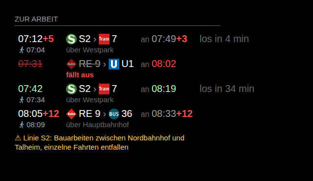

# MMM-VGN

[MagicMirror²](https://github.com/MagicMirrorOrg/MagicMirror)-Modul für den **VGN** (Nürnberg und Franken):
die nächsten **Verbindungen von A nach B** mit Zügen, S-/U-Bahn, Tram und Bus, mit **Echtzeit-Verspätung**,
**Ausfällen** und **Störungsmeldungen**. Kein API-Schlüssel nötig.

*English: shows the next public transport connections between two stops in the VGN area (Nuremberg, Franconia)
with real-time delays, cancellations and disruption notices. No API key required.*



*(Beispieldaten)*

- Planzeit und Verspätung: `05:23+5`, das `+5` in Rot. Pünktliche Fahrten mit Echtzeitdaten erscheinen grün.
- Ausfälle werden durchgestrichen und mit „fällt aus“ markiert.
- Umstiege mit Linien-Logos (`S1 › 5`) und Umstiegshaltestelle.
- Optional Fußweg von zu Hause: Losgehzeit unter der Abfahrt und Countdown bis zum Losgehen.
- Störungen und Bauarbeiten der beteiligten Linien. Abgelaufene Meldungen („… bis 23.10.“) werden ausgeblendet.

Anders als reine Abfahrtstafeln (z. B. MMM-VAG) rechnet das Modul echte Verbindungen. Damit funktionieren auch
Strecken mit Umstieg und Haltestellen außerhalb Nürnbergs, einschließlich Regionalzügen.

## Installation

```bash
cd ~/MagicMirror/modules
git clone https://github.com/SpecterAoD/MMM-VGN
```

Keine weiteren Abhängigkeiten (Node.js ≥ 18, `fetch` ist eingebaut).

## Konfiguration

```js
{
  module: "MMM-VGN",
  position: "bottom_left",
  header: "Zur Arbeit",
  config: {
    from: "<Start-Haltestelle>",     // Name oder globale Kennung "de:…"
    to: "<Ziel-Haltestelle>",
    walkFrom: "<Ort, Straße Nr.>",   // optional: Fußweg von zu Hause
    maxConnections: 4
  }
}
```

| Option | Standard | Bedeutung |
|---|---|---|
| `from`, `to` | – | Start und Ziel: Haltestellenname (wird beim Start einmal gesucht, Treffer im Log) oder globale Kennung `de:…` |
| `maxConnections` | `4` | Anzahl der Verbindungen |
| `updateInterval` | `120` | Abfrage alle N Sekunden (mindestens 60, nachts 1–4 Uhr fünfmal seltener) |
| `minTimeUntilDeparture` | `0` | zusätzliche Minuten Puffer: frühere Abfahrten werden nicht gezeigt |
| `walkFrom` | `""` | Adresse (`"Ort, Straße Nr."`): Gehzeit zur Starthaltestelle wird geschätzt (Luftlinie × `walkFactor` bei `walkSpeed`), Ergebnis steht im Log. Unter der Abfahrt erscheint dann die Losgehzeit (Symbol Fußgänger + 05:13), der Countdown zählt bis zum Losgehen, nicht mehr erreichbare Verbindungen fallen weg |
| `walkMinutes` | `0` | Gehzeit fest vorgeben (hat Vorrang vor `walkFrom`) |
| `walkIgnoreDelayBelow` | `10` | Verspätungen unter so vielen Minuten zählen für die Losgehzeit nicht (könnten aufgeholt werden), größere schon |
| `walkFactor` | `1.3` | Umweg gegenüber der Luftlinie |
| `walkSpeed` | `4.8` | Gehgeschwindigkeit in km/h |
| `excludeProducts` | `[]` | Verbindungen mit diesen Verkehrsmitteln weglassen: `"bahn"`, `"sbahn"`, `"ubahn"`, `"tram"`, `"bus"` oder Liniennamen wie `"RE 31"` |
| `allowWalkAtStart` | `true` | `false`: Verbindungen weglassen, die mit einem Fußweg zu einer anderen Haltestelle beginnen |
| `showVia` | `true` | Umstiegshaltestellen anzeigen |
| `showArrival` | `true` | Ankunftszeit anzeigen |
| `showCountdown` | `true` | „in 12 min“ anzeigen |
| `countdownMax` | `60` | Countdown nur bis so viele Minuten vor Abfahrt |
| `showInfos` | `true` | Störungsmeldungen anzeigen |
| `maxInfos` | `2` | höchstens so viele Meldungen |
| `ignoreInfos` | `[]` | Meldungen ausblenden, die einen dieser Textteile enthalten (ohne Groß-/Kleinschreibung) |
| `delayThreshold` | `1` | ab so vielen Minuten Verspätung rot |
| `apiBase` | `https://efa.vgn.de/vgnExt_oeffi` | Adresse der Verbindungsauskunft |

**Kennung herausfinden:**
`https://efa.vgn.de/vgnExt_oeffi/XML_STOPFINDER_REQUEST?outputFormat=rapidJSON&type_sf=any&name_sf=<Name>`
→ Feld `id` des Eintrags mit `"type": "stop"`. Meist reicht der Name; welche Haltestelle gefunden wurde, steht beim Start im Log.

## Datenquelle

Verbindungsauskunft (EFA) des Verkehrsverbunds Großraum Nürnberg (VGN), dieselbe Quelle wie die VGN-Fahrplanauskunft.
Die Schnittstelle ist öffentlich erreichbar, aber nicht offiziell dokumentiert. Wenn sie sich ändert, zeigt das
Modul „keine Verbindungen“ bzw. eine Fehlermeldung, der Spiegel läuft normal weiter.

## Entwicklung

```bash
npm test     # node --test test/
npm run preview -- --from "<Start>" --to "<Ziel>" --config '{"walkFrom":"<Ort, Straße Nr.>"}'
```

Die Vorschau zeigt das Modul mit Echtdaten unter http://localhost:8099 (ohne MagicMirror), `/?demo=1` zusätzlich mit
Beispiel-Verspätung und -Ausfall.

## Lizenz

MIT. Die Verkehrsmittel-Symbole (außer `walk.svg`) stammen aus [MMM-VAG](https://github.com/wiesty/MMM-VAG) (MIT, © Wiesty).
